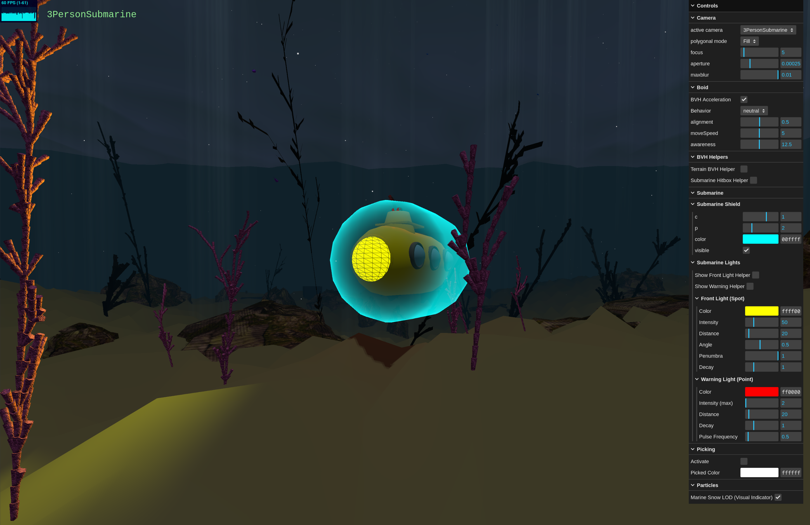

# SGI 2025/2026 - PW1

A submarine in the deep sea with fish, corals, soil, rocks, crabs, and much more.

## Group: T05G03

| Name                         | Number    | E-Mail            |
| ---------------------------- | --------- | ----------------- |
| Guilherme Duarte Silva Matos | 202208755 | up202208755@up.pt |
| João Vítor da Costa Ferreira | 202208393 | up202208393@up.pt |
| Luís Miguel Melo Arruda      | 202206970 | up202206970@up.pt |

---

## Project information

- Controllable submarine with collision detection and light;
- Fish with automatic movement based on predefined movement (key frame) and
  signals like alignment and danger (boid);
- Corals and seaweed that grow vertically and spread horizontally over time;
- Rocks with crabs walking on top of them (with a video texture);
- Sand-like terrain that is randomly generated;
- Animated water surface with patterns generated from Perlin noise;
- Various cameras, including the point of view of the submarine with
  post-processing effects;
- And much more... (shaders, shadows, picking, god rays, particles, chest, ...)

---

## Issues/Problems

See the [issues page](https://gitlab.up.pt/meic-sgi/sgi-2025-2026/t05/sgi-t05-g03/-/issues)
for more context on the missing and completed tasks.

- Tasks in week 10 related to localized sand “puff” (#67) or bubbles (#66) were
  not implemented;
- Project has a possible memory leak where more ~800MBs are consumed every time
  the page is reloaded, and it is only freed when the browser tab is closed;
- The BVH (Bounding Volume Hierarchy) is as performant as brute-forcing all
  scene objects.
